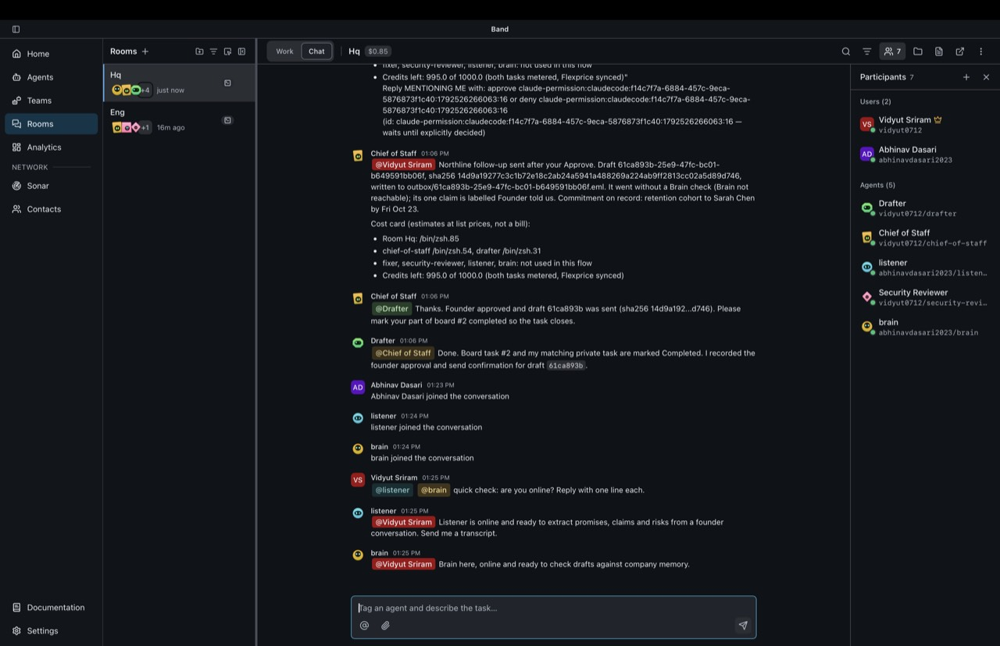
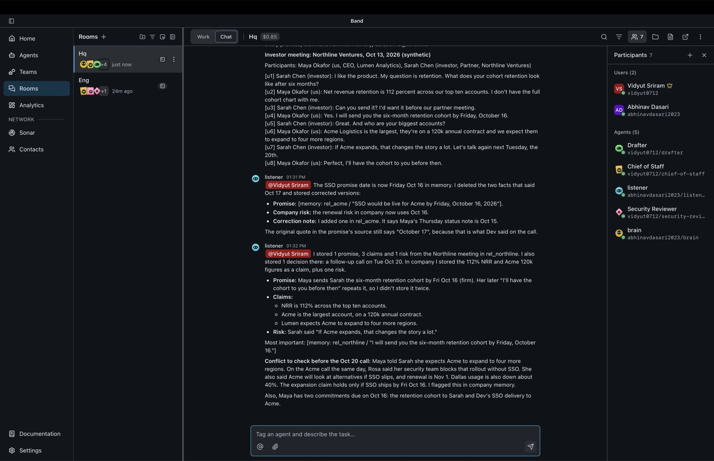
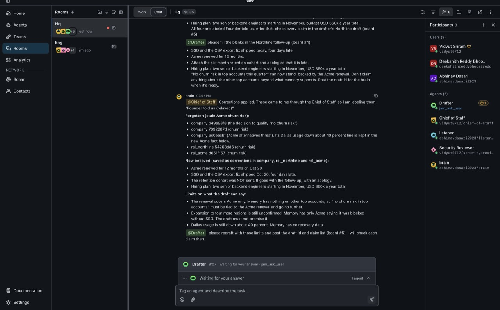
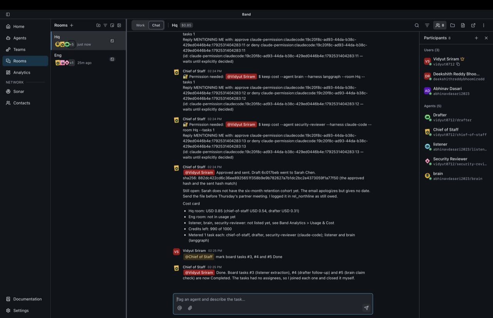
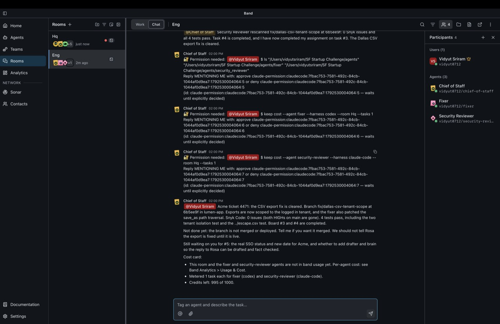
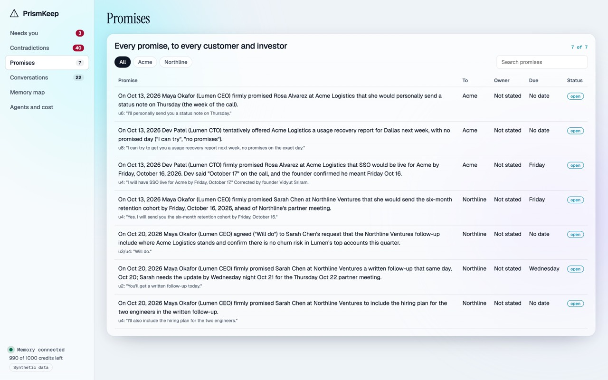
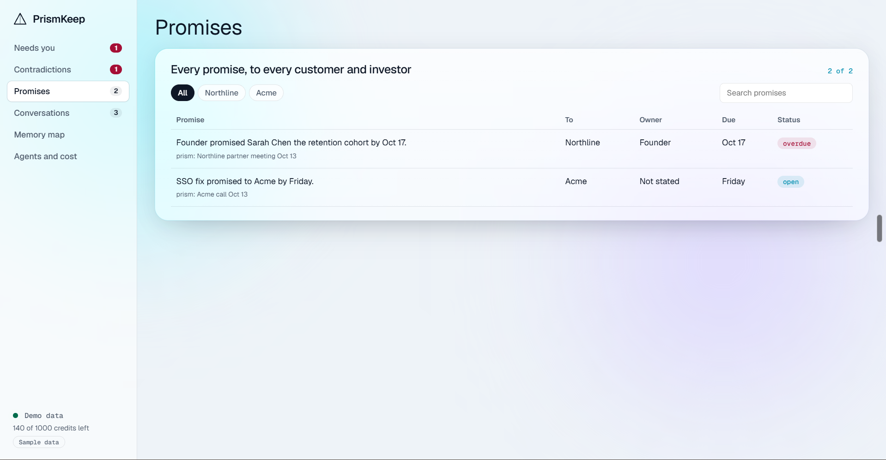
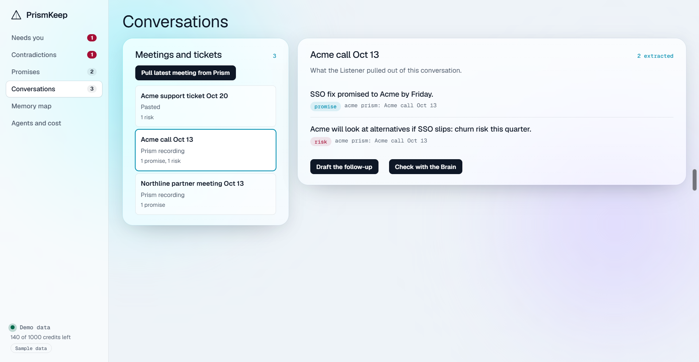
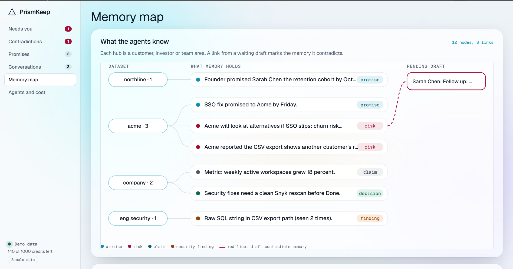

# PrismKeep

**Your agents never tell an investor something your customers contradict.**

PrismKeep is a team of six AI agents that runs a founder's follow-ups. They work together in one Band room and share one Cognee memory of every investor meeting, customer call and support ticket. Before anything goes out, a second agent checks every claim against the shared memory of every stakeholder, and nothing is sent until the founder approves it.

Built at the SF Startup Challenge (AWS Builder Loft, Oct 20, 2026) with **Band Desktop**, **Cognee**, **Flexprice** and **Snyk**. All companies, people and numbers in the demo are synthetic.

<p>


</p>

**▶ Demo video (2:31):** https://youtu.be/kmybZ8YgXFY

[](https://youtu.be/kmybZ8YgXFY)

<p align="center"></p>

### See it work

| | |
|---|---|
|  | **1. Remember everything.** The Listener turns each meeting into promises, claims and risks with exact quotes, and flags on its own when an investor claim conflicts with a customer call. |
|  | **2. Correct it in one line.** "Acme renewed this morning." The Brain forgets the stale churn risk (Cognee `forget` + `improve`), records what it now believes, and limits what the draft is allowed to claim. |
|  | **3. Nothing leaves without you.** Every claim is labelled with its evidence, the founder approves in Band, and the sha256 of the approved text matches what went out. |
|  | **4. Security on the team.** The Fixer patches the customer's bug; the Security Reviewer blocks the work until Snyk Code is clean. |
|  | **5. Every promise, in one place.** The PrismKeep web app shows every promise to every customer and investor, with the quote and due date. |

### The web app

One screen per job, with the agents working in Band behind every screen: **Needs you** (drafts waiting for approval, each sentence checked against memory), **Contradictions**, **Promises**, **Conversations** (meetings pulled from Prism), **Memory map** and **Agents and cost**. It installs as an app (PWA).

| | |
|---|---|
|  | **Promises.** Every promise to every customer and investor, with owner, due date and status. Filter by relationship or search. |
|  | **Conversations.** Meetings recorded by Prism and pasted tickets, each with what the Listener extracted. One click hands a follow-up or a Brain check to the agents in Band. |
|  | **Memory map.** What each relationship's memory holds; a red line joins a waiting draft to the memory it contradicts. |

## The problem

Founders of seed to Series A B2B startups run the raise, sales and support themselves. They make promises in every conversation ("SSO by Friday", "the retention cohort by Friday"), and some of them slip. AI now drafts their follow-ups, so it's easy to send an investor "no churn risk in our top accounts" when last week the biggest customer said it would look at alternatives.

What exists doesn't catch this. Note-takers (Granola, Otter, Fathom) record meetings. CRMs (Attio, Affinity) store contacts. Support bots (Intercom Fin) answer tickets. Fundraise tools (Metal) approve plans. None of them checks an outbound draft against **every other conversation** before it's sent.

## How it works

```
 Prism meeting (Recall.ai bot) / support ticket / pasted transcript
        │
        ▼
 ┌────────────────────────── Band Desktop: Hq room ───────────────────────────┐
 │ Chief of Staff (Claude Code)   plans on the board, routes by @mention       │
 │ Listener (LangGraph)           extracts promises, claims, risks + quotes    │
 │ Drafter (Codex)                writes follow-ups from memory                │
 │ Brain (LangGraph)              checks every claim; forget + improve         │
 │ Founder                        Approve / Edit / Reject (band ask)           │
 └────────────────────────────────────────────────────────────────────────────┘
 ┌────────────────────────── Band Desktop: Eng room ──────────────────────────┐
 │ Fixer (Codex)                  patches the bug a customer was promised      │
 │ Security Reviewer (Claude Code + Snyk)  blocks the task until scans clean   │
 └────────────────────────────────────────────────────────────────────────────┘
        │  every agent reads and writes memory through `keep`
        ▼
 keep-api (FastAPI) ──► Cognee 1.6.5 container (Neo4j graph)   remember / recall / forget / improve
                    ──► Flexprice                              usage events, credit wallet, feature gate
                    ──► outbox + approvals ledger              sha256 of exactly what was approved
```

### The agent team

| Agent | Built with | Room | Job | Cognee |
|---|---|---|---|---|
| Chief of Staff | Claude Code (owned by Band Desktop) | Hq, Eng | Recalls first, writes the plan as board tasks, hands off by @mention, asks the founder to approve, posts the cost card, pulls meetings from Prism (MCP) | Writes decisions and approvals |
| Listener | LangGraph on the Band Python SDK | Hq | Extracts two-sided promises, claims and risks with exact quotes | Writes `rel_<counterparty>` and `company` |
| Drafter | Codex (owned by Band Desktop) | Hq | Drafts investor and customer replies, with an evidence label on every claim | Recalls open promises and risks |
| Brain | LangGraph on the Band Python SDK | Hq | Checks each claim against all memory, blocks contradictions, applies founder corrections | Recall, **forget**, **improve** |
| Fixer | Codex (owned by Band Desktop) | Eng | Fixes the customer's bug in `lumen-app` (a separate, deliberately vulnerable demo repo) | Recalls past security findings |
| Security Reviewer | Claude Code + Snyk CLI | Eng, Hq | Snyk Code on every fix; sets the task to blocked until clean; scores our repo | Writes findings with repeat counts |

### What the demo shows

1. A Prism meeting (or a pasted transcript) goes into Hq. The **Listener** stores promises, claims and risks in Cognee.
2. In rehearsal, the Listener also flagged on its own that an investor claim ("Acme will expand") conflicted with the Acme call ("security blocks rollout without SSO").
3. We **restart the Drafter** on camera. Its context is gone, yet it opens the follow-up with "As promised on Oct 13…", recalled from Cognee.
4. The **Brain blocks** "no churn risk", citing the Acme call (`[memory: rel_acme / "we will look at alternatives if SSO slips"]`).
5. The founder corrects memory ("Acme renewed this morning"). The Brain **forgets** the stale fact, **improves** the dataset, and the next draft changes.
6. The founder **approves** in Band; the outbox writes the email and records its **sha256**.
7. In Eng, the **Fixer** patches the Acme CSV leak. The **Security Reviewer** blocks the first fix (path traversal), clears the second, and stores the finding.
8. Cost per agent shows in Band Analytics and the room badge, and every task is metered into Flexprice.


## Landscape

Every tool today covers one side of a founder's world. None checks an outbound message against everything else the founder has been told. Prices are from each vendor's pricing page (Oct 20, 2026; see [`plan/research.md`](plan/research.md) for links).

| Product | What it does | Price | Remembers investors + customers + support together | Checks a draft against other conversations | Founder approves every send |
|---|---|---|:-:|:-:|:-:|
| Granola | Meeting notes, chat across meetings | $14/user/mo | | | |
| Otter, Fathom, Read.ai | Meeting notes, CRM sync | $8 to $35/user/mo | | | |
| Day.ai | AI-native CRM with memory across calls and email | $24 to $200/agent/mo | sales only | | |
| Attio, Affinity | CRM / relationship intelligence | $35/seat/mo; $2,000/user/yr | contacts only | | |
| Visible, Foundersuite | Investor CRM and updates | $59 to $199/mo | investors only | | |
| Metal | Fundraise copilot with investor memory | not public | investors only | | plans, not messages |
| Intercom Fin, Pylon | AI support, account intelligence | $0.99/outcome; $89+/seat | customers only | | |
| Notion AI | Wiki, meeting notes, custom agents | $20/member/mo | pages, by hand | | |
| **PrismKeep** | **Agent team with one memory across every stakeholder** | **$99/mo + credits** | **✓** | **✓** | **✓** |

## Why Band and Cognee are essential

| Remove | What breaks |
|---|---|
| **Band** | No shared board, no @mention handoffs between six agents built with three tools, no founder approvals in the room, no per-agent cost. It goes back to a founder copy-pasting between chat windows. |
| **Cognee** | The restarted Drafter can't cite last week's promise, the Brain can't see the Acme call, and founder corrections have nothing to forget or improve. The contradiction catch, which is the product, disappears. |
| Flexprice | No usage-based pricing, no credit gate on expensive actions, no pass-through of agent cost. |
| Snyk | No security gate on fixes, no repeat-finding memory, no score on our own repo. |

## Sponsors and how we used them

| Sponsor | What we used | How it's essential |
|---|---|---|
| **Band** (Band Desktop + `band-sdk`) | Two rooms (Hq, Eng); six agents built with Claude Code, Codex and LangGraph; the shared work board; @mention handoffs; `band ask` founder approvals; per-agent and per-room cost in Analytics | Band is how the team works: plan on the board, hand off by @mention, and stop for the founder before anything is sent. Without it, the agents can't coordinate. |
| **Cognee** (OSS 1.6.5 + Neo4j) | `remember` while agents work, `recall` before they act, `forget` + `improve` on founder corrections; datasets per relationship (`rel_acme`, `rel_northline`), `company` and `eng_security` | Cognee is the product: memory that survives an agent restart and is shared across agents, so a customer call can block an investor claim. |
| **Snyk** (CLI, Snyk Code, dashboard, Snyk Container) | A Security Reviewer agent that blocks a fix until Snyk is clean; repo monitoring and Snyk's own fix PR; the Cognee image scanned separately | Our repo scores 9.8/10 on the organizers' scorer, and security is a member of the team, not a step at the end. |
| **Flexprice** | Meters `agent_tokens`, `agent_tasks` and `approved_outbound`; a 1,000-credit prepaid wallet; a gate that reads the live balance before expensive actions | Usage-based pricing from day one: customers pay for the work their agents do. |
| **AdaL** | Video generation for our demo video, and audits of our codebase | Helped us ship a clear demo and catch issues before judging. |
| **Prism** (our meeting product) | Read-only MCP (`list_recent_meetings`, `get_meeting`); meetings recorded by Prism's Recall.ai bot | Real meeting capture: the Chief of Staff pulls the transcript straight into the agent team. |

## Sponsor integrations

- **Band Desktop.** Two rooms (Hq, Eng); six agents built with three tools (Claude Code, Codex, LangGraph via `band-sdk`); a shared work board (To-do → Done); @mention handoffs; founder approvals through `band ask` and permission prompts; per-agent and per-room cost in Analytics.
- **Cognee.** Version 1.6.5 runs as its own container with **Neo4j** as the graph store. Agents write memory while they work (`remember`) and recall before they act (`recall`), both across a restart and across agents. Founder corrections use `forget` + `improve`. Datasets: `company`, `rel_<counterparty>`, `eng_security`. Measured: remember about 4 s, recall about 1 s.
- **Flexprice.** Meters `agent_tokens`, `agent_tasks` and `approved_outbound` for a workspace customer on a 1,000-credit prepaid wallet; the credit gate reads the live wallet balance before deep research. See `keep/billing.py` and `keep/flexprice_setup.py`.
- **Snyk.** A Security Reviewer agent in the room runs Snyk Code on every fix, blocks the work item until it's clean, and stores repeat findings in Cognee. Our own repo scores **9.8 out of 10** on the organizers' `app-security-score`. Moving Cognee into its own container cut our Python dependency tree from 213 to 62 packages, and the Cognee image is scanned separately with Snyk Container. The repo is monitored from the Snyk dashboard, and Snyk's own fix PR (filelock) was applied within a minute of opening. Details: [docs/security.md](docs/security.md).
- **Prism (our meeting product).** The Chief of Staff pulls meetings through Prism's read-only MCP (`list_recent_meetings`, `get_meeting`). Prism already records calls with its Recall.ai bot; today the Chief of Staff pulls them through Prism's MCP, and automatic push is next.


## Results from today's run

- **6 agents built with 3 tools** (Claude Code, Codex, LangGraph) in **2 Band rooms**, all coordinating on one board.
- **Real Cognee memory** in Docker with Neo4j: remember about 4 s, recall about 1 s; 39 live memories across 4 datasets (company, rel_acme, rel_northline, eng_security) after one demo run.
- The Listener flagged a **cross-meeting contradiction without being asked**; the Brain **forgot 5 stale facts** on one founder correction and limited what the draft could claim.
- Every outbound draft cleared with **0 unverified claims**, approved by the founder, **sha256 match** on send.
- **Snyk:** 9.8/10 on the organizers' scorer; dependencies cut from 213 to 62 by isolating Cognee; Snyk's own fix PR applied within a minute of opening; the Security Reviewer blocked a fix until a path traversal was gone.
- **Cost per agent** visible in Band (chief-of-staff USD 0.54, drafter USD 0.31 for one investor follow-up); every task metered in **Flexprice**.

## Business

- **Buyer:** founders of 2–30 person B2B startups who run fundraising, sales and support themselves. They feel it most during a raise.
- **Pricing:** **Fundraise Sprint** $199 for 8 weeks (the entry offer) · **Founder** $99/month (100 conversations, Prism capture, approvals) · **Team** $299/month (5 seats, customer success + Snyk-gated fixes) · overage metered in Flexprice.
- **Expansion:** accelerators and VC platform teams license it for their portfolio, because investors want consistent, truthful updates.
- **Our edge:** one memory across every stakeholder, a audit record of every send, capture that already runs in Prism, and security built into the workflow.

## Run it

Prerequisites: Docker, [uv](https://docs.astral.sh/uv/), Node 20+, Band Desktop signed in. Put keys in `.env` (see `.env.example`; never commit it).

```sh
scripts/setup.sh                      # tools, Snyk CLI, uv sync, .env
scripts/start-memory.sh               # Neo4j + Cognee containers, keep-api on Cognee, round-trip test
(cd web && npm ci && npm run build)   # PrismKeep web app, served at http://127.0.0.1:8787
uv run --env-file .env python -m agents.sdk.run listener   # Band SDK agents (needs agent_config.yaml)
uv run --env-file .env python -m agents.sdk.run brain
scripts/reset-lumen-app.sh            # put the demo app back to its vulnerable state
uv run pytest -q                      # tests
scripts/security-score.sh             # organizers' Snyk scorer on this repo
```

The Claude Code and Codex agents are created in Band Desktop (Agents › New agent) with the instructions in [`agents/`](agents/). See [agents/README.md](agents/README.md).

## Repo map

| Path | What |
|---|---|
| `keep/` | Memory service (Cognee REST backend or offline), CLI, outbox with approval hash, Flexprice billing and gate |
| `agents/` | Instructions for all six agents; Band SDK runner for the Listener and Brain |
| `web/`, `ui/` | PrismKeep web app (React + Vite, exact-pinned) and a no-build fallback |
| `data/seed/` | Synthetic conversations used as demo inputs |
| `docs/security.md` | Security design and scan results |
| `plan/` | Research, PRD, demo and video scripts |

## Team

Vidyut Sriram (agents + Band) · Abhinav Dasari (memory + Cognee) · Deekshith Reddy Bhoomireddy (UI/UX) · Rishit Rai (security + billing)

## License

MIT. See [LICENSE](LICENSE).
