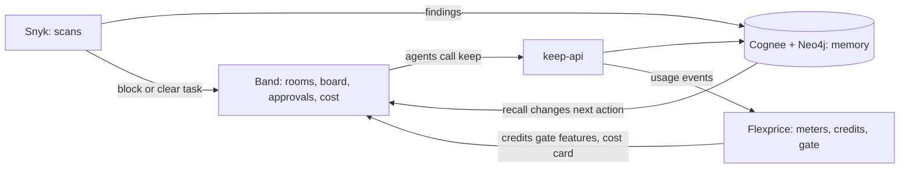

# How the four tools score together

This folder explains how Band, Cognee, Flexprice and Snyk connect, and which demo beat earns which points. Update the "Evidence" column as each beat works.

## The loop

Each tool depends on another, so removing one breaks the demo:

| Remove | What breaks |
|---|---|
| Band | No board, handoffs, approval or per-agent cost |
| Cognee | No restart recall, no cross-agent block, no correction effect |
| Flexprice | No credit gate, no cost pass-through |
| Snyk | No blocked task, no repeat-finding memory, no repo score |

## Points map

| Criterion | Weight | Beat | Evidence | Status |
|---|---|---|---|---|
| Band | 25 | Two rooms, six agents, board To-do to Done, approval, cost view | video 0:12, 2:15, 2:35 | not started |
| Cognee | 25 | Restart recall, cross-agent block, forget and improve, Neo4j | video 1:05 to 2:15 | not started |
| Viability | 20 | Buyer, price, why now | README, ideas.md | drafted |
| Execution and demo | 20 | One live run, UI, 3:00 video | video, ui/ | not started |
| Innovation | 10 | Memory limits what is said to investors | pitch line | drafted |
| Flexprice | +10 | Real events, credits gate deep research | dashboard capture | not started |
| Snyk | +10 | Blocked task, repeat finding, real repo score | Eng room, scorer report | not started |

## Where we stand now (self score)

Score each criterion 0 to 5, then points = score x weight / 5 (max 130 with both bonuses). Be strict: a feature only counts when it has run in a real Band room or against the real service, not when the code merely exists. Update this table at every checkpoint and add a row to the history below.

| Score | Meaning |
|---|---|
| 0 | Nothing exists |
| 1 | Written (code, prompts or docs) but never run |
| 2 | Runs locally or offline only |
| 3 | Runs against the real tool once |
| 4 | Runs reliably and is on video |
| 5 | Judges can see it change agent behavior live |

| Criterion | Weight | Now (0 to 5) | Points now | Target | Points target | What is missing |
|---|---|---|---|---|---|---|
| Band | 25 | 1 | 5.0 | 5 | 25 | Band Desktop not yet signed in, no room, no board run, agents not attached |
| Cognee | 25 | 1 | 5.0 | 5 | 25 | Real Cognee plus Neo4j not yet run, no timed remember and recall, no restart proof |
| Viability | 20 | 3 | 12.0 | 4 | 16 | Prices still unverified live, no customer evidence beyond research |
| Execution and demo | 20 | 1 | 4.0 | 4 | 16 | No end-to-end run, no video, UI is a starter |
| Innovation | 10 | 2 | 4.0 | 4 | 8 | Contradiction block designed but never shown |
| Flexprice | 10 | 1 | 2.0 | 4 | 8 | No API key, no event sent, no wallet or gate run |
| Snyk | 10 | 1 | 2.0 | 3 | 6 | No token, no baseline score, no block and unblock cycle |
| **Total** | **130** | | **34.0** | | **104** | |

Basis for "Now": the repo has keep-api, the CLI, billing client, outbox, agent instructions, seed data and a UI starter. The team reports 9 passing tests, which I have not re-run. Nothing has been run against Band, real Cognee, Flexprice or Snyk yet.

### Per tool readiness

| Tool | Installed or signed in | Configured | Run once | On video | Next action |
|---|---|---|---|---|---|
| Band Desktop | no | no | no | no | Install, sign in, create HQ and Eng rooms, one @mention round trip |
| Cognee | pinned in lockfile | no | no | no | Neo4j up, `KEEP_BACKEND=cognee`, time remember, recall, forget |
| Flexprice | no key | no | no | no | Get sponsor key, send one `keep cost` event |
| Snyk | no token | no | no | no | Create PAT, run `scripts/security-score.sh --quick`, record baseline |

Tick a cell only when it is true today.

### Score history

| Time | Total | Band | Cognee | Viability | Execution | Innovation | Flexprice | Snyk | Note |
|---|---|---|---|---|---|---|---|---|---|
| start of build | 34.0 | 5 | 5 | 12 | 4 | 4 | 2 | 2 | Code and docs written, nothing run live |

## Snyk beyond code fixes (proposed)

1. Evidence tier "Scan verified": Brain blocks a security claim in a draft unless the latest scan in memory supports it.
2. A promise like "fix the export leak" is marked kept only with a clean rescan reference.
3. Dependency gate: the reviewer scans any package an agent adds.
4. Scan trends stored in `company` memory so investor updates and customer questionnaires use real posture.
5. Billing: "security-gated fix" is a metered, charged action in Flexprice.

## Security score record

Record every scorer run here and in `plan/progress.md`. Never write a number that was not produced by a real run.

| Time | Raw `snyk test` | `snyk code test` | Scorer result | Note |
|---|---|---|---|---|
| baseline | | | | |

| 2026-10-20 after path fix | not scanned (Snyk service 503, uv.lock) | 0 issues (was 4 low) | not run | keep/paths.py confines env and CLI paths |
