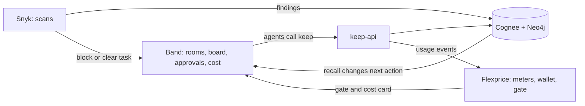

> **Historical checkpoint log, not current status.** For results from the final run, see the README's "Results from today's run".

# Scoring: where we stand and how the four tools earn points

One page for the whole team. Update it at every checkpoint (11:50, 12:30, 13:15, 13:45, 14:00). Rule: a number goes in only if a real run produced it.

Last updated: 2026-10-20, after Rishit's Flexprice merge and the path-traversal fix.

## 1. Scoreboard (self score, strict)

Points = score x weight / 5. Max is 130 with both bonuses.

| Score | Meaning |
|---|---|
| 0 | Nothing exists |
| 1 | Written (code, prompts, docs) but never run |
| 2 | Runs locally or offline only |
| 3 | Runs against the real tool once |
| 4 | Runs reliably and is on video |
| 5 | Judges see it change agent behavior live |

| Criterion | Weight | Now | Points | Target | Target pts | Evidence now | Biggest gap |
|---|---|---|---|---|---|---|---|
| Band | 25 | 3 | 15.0 | 5 | 25 | Per Vidyut's status board (not re-run by me): HQ and Eng rooms live, 6 agents on 3 tools, board task routed by @mention, `band ask` approval, approve-and-send with sha256 passed at 1:06, Snyk-gated fix passed at 12:47, per-agent cost in Analytics | Not on video yet; restart on camera; Drafter and Brain flows still in rehearsal |
| Cognee | 25 | 3 | 15.0 | 5 | 25 | PR #3 merged: Cognee as a container behind keep-api, ledger-scoped recall, forget and improve; 29 tests pass. I ran it live on this machine: Cognee and Neo4j containers healthy, keep-api on CogneeBackend, remember 8s, recall 3s (a reworded query hit), forget ok | No restart or cross-agent proof on video; Neo4j view not shown |
| Viability | 20 | 3 | 12.0 | 4 | 16 | Buyer, price, why now, competitor research | Prices not verified live; no customer evidence |
| Execution and demo | 20 | 3 | 12.0 | 4 | 16 | UI built and served live by keep-api on real Cognee (shows backend, memories, credits); simplified to one connections list | No end-to-end run with Band agents; no video |
| Innovation | 10 | 2 | 4.0 | 4 | 8 | Contradiction check designed and drawn | Brain never produced a real block |
| Flexprice | 10 | 3 | 6.0 | 4 | 8 | Gate denial shown from the live wallet using a 50 credit demo customer (`lumen_lowcredit`); setup ran against the real Flexprice account (customer, 3 meters, plan, subscription, wallet); I sent one cost event, flexprice_synced True; gate reads the live wallet | Not on video; no dashboard capture; local and Flexprice balances differ (async) |
| Snyk | 10 | 3 | 6.0 | 4 | 8 | Organizers' scorer ran for real (Rishit, public URL): 9.8 of 10, 9.9 after the md5 fix; Snyk Code now 0 issues (my rescan on main); scan wrapper `scripts/snyk-scan.sh` and `.snyk` (Python 3.12) merged in PR #4 | Scorer's own dependency scan did not run (Rishit's separate scan: 61 deps, 1 low); reviewer loop never run in Band |
| **Total** | **130** | | **70.0** | | **106** | | |

History (add a row each checkpoint):

| Time | Total | Band | Cognee | Viab | Exec | Innov | Flex | Snyk | Note |
|---|---|---|---|---|---|---|---|---|---|
| start of build | 34.0 | 5 | 5 | 12 | 4 | 4 | 2 | 2 | Code and docs only |
| after UI, path fix, Flexprice merge | 49.0 | 5 | 10 | 12 | 8 | 4 | 6 | 4 | 17 tests pass; nothing live in Band yet |
| after PR #3 merged to main | 54.0 | 5 | 15 | 12 | 8 | 4 | 6 | 4 | 29 tests pass; Cognee in a container; Band still not run |
| after PR #4 merged to main | 54.0 | 5 | 15 | 12 | 8 | 4 | 6 | 4 | Snyk tooling added, no new run, so no change |
| after build/agents-band merged | 56.0 | 5 | 15 | 12 | 8 | 4 | 6 | 6 | Official scorer 9.8 (Rishit); code 0 issues; gate denial shown live |
| after live Cognee run and UI on keep-api | 60.0 | 5 | 15 | 12 | 12 | 4 | 6 | 6 | Real round trip on Cognee; Band signed in but no room yet |
| after Vidyut's status board (2:15 PM) | 70.0 | 15 | 15 | 12 | 12 | 4 | 6 | 6 | Band rooms, 6 agents, approval and Snyk-gated fix reported passed; not yet on video |

## 2. How the four tools depend on each other

| Remove | What breaks |
|---|---|
| Band | No board, handoffs, founder approval or per-agent cost |
| Cognee | No restart recall, no cross-agent block, corrections change nothing |
| Flexprice | No credit gate, no cost pass-through |
| Snyk | No blocked task, no repeat-finding memory, no repo score |

## 3. Snyk: the real picture

### How the organizers score us
Score = 10 - (critical x 3 + high x 1 + medium x 0.3 + low x 0.1). More than 10 findings above low scores 0. They run `snyk test --all-projects` and `snyk code test`.

### Where we are

| Scan | Result | Source |
|---|---|---|
| Snyk Code (our code) | 0 issues on main. The 2 low findings after PR #3 were hashlib.md5 for Cognee file names, now marked usedforsecurity=False | my run on main, 2026-10-20 |
| Dependencies after PR #3 | Vidyut reports 213 to 62 deps, 0 known vulns (`cognee` and `langchain-community` moved out into a container). Repo now has `requirements.txt`. My `snyk test --file=requirements.txt` fails with "Missing required packages" because it needs them installed, so I have not confirmed the number | Vidyut, unverified by me |
| Snyk Open Source on the repo as is | "No supported files found". Snyk does not read `uv.lock` | my run and Rishit's baseline |
| Same tree exported to requirements.txt (outside the repo) | 210 deps: 5 critical, 18 high, 7 medium, 2 low | Rishit's baseline in `plan/progress.md` |
| Organizers' Docker scorer | Not completed. Docker is running now, but the scorer's `tar` step fails on a Windows path | my run |
| Snyk Container (Neo4j image) | Not run | |

### The risk to take seriously
If the organizers' scorer manages to read our dependencies, the count above is far over the limit of 10 and the score is **0**. If it cannot read them (as happens today), the notes will say "dependency scan did not run". We do not know which way it goes, so plan for the bad case.

Sources of the findings (from Rishit's baseline):

| Package | Pulled in by | Fix |
|---|---|---|
| pillow 12.3.0 | fastembed | 13.0.0, blocked by fastembed pin |
| onnxruntime 1.23.2 | cognee | 1.24.1, blocked by cognee pin |
| litellm 1.106.0, diskcache 5.6.3 | cognee | none |
| langchain-community 0.4.2 (critical SSRF) | band-sdk[langgraph] | none |

Options to decide (Vidyut and Rishit):
1. Drop `fastembed` and use a hosted embedding provider, which removes the pillow finding.
2. Check whether the `langgraph` extra of the Band SDK is needed. Removing it removes the critical SSRF.
3. Explain what cannot be fixed in `docs/security.md`. Do not add ignores to hide findings.
4. Run the real scorer on Linux (WSL) and record the true number before deciding anything.

### Snyk against the brief

| Brief asks | Status |
|---|---|
| Snyk CLI and Snyk Code | Works, token in `.env` |
| Dependencies | Blocked (above) |
| Containers | Not done |
| Reviewer agent in the Band room | Written, now calls `scripts/snyk-scan.sh` (PR #4), never run in a room |
| Posts findings, blocks the work item | Designed, needs Band board |
| Stores recurring issues in Cognee | Designed (`keep remember --dataset eng_security`), never run on real Cognee |

### Using Snyk beyond code fixes (proposed)
1. Evidence tier "Scan verified": Brain blocks a security claim in a draft unless a stored scan supports it.
2. A promise like "fix the export leak" counts as kept only with a clean rescan reference.
3. Dependency gate: the reviewer scans any package an agent adds.
4. Scan trends stored in `company` memory so investor updates cite real posture.
5. "Security-gated fix" is a metered, charged action in Flexprice.

Snyk detects and suggests the fixed version. `snyk fix` does not support `uv`, so our Fixer agent applies fixes.

### Security score record
Record every run here and in `plan/progress.md`.

| Time | `snyk test` | `snyk code test` | Organizers' scorer | Note |
|---|---|---|---|---|
| baseline (Rishit) | no supported files; exported tree 5C/18H/7M/2L | 4 low | not run | Docker missing then |
| after path fix | not scanned (Snyk 503 on uv.lock) | 0 issues | fails on Windows path | `keep/paths.py` |
| after PR #3 | not confirmed (Vidyut: 62 deps, 0 vulns) | 2 low | not run | Docker scorer still fails on Windows path |

## 4. Demo beat checklist

Tick only when the beat has run for real and been recorded.

| Beat | Time | Points it earns | Done |
|---|---|---|---|
| Two rooms, six agents, plan on the board | 0:12 | Band | no |
| Cognee recall in the Chief of Staff message | 0:12 | Cognee | no |
| Fixer recalls past finding, Snyk blocks, fix, clean rescan | 0:35 | Snyk, Cognee, Band | no |
| Restart Drafter and memory, recall still works | 1:05 | Cognee | no |
| Brain blocks "no churn" using the Acme call | 1:20 | Cognee, Innovation | no |
| Founder correction: forget and improve, redraft | 1:50 | Cognee | no |
| Founder approval through `band ask`, hash shown | 2:15 | Band | no |
| Band usage view, cost card, credit gate denies | 2:35 | Band, Flexprice | no |
| End card with the real scorer number | 2:52 | Snyk | no |

## 5. Next actions, in order

1. Confirm the dependency count with the organizers' scorer (Linux container). The old critical findings should be gone with Cognee moved out.
2. Band gate: sign in, one room, one @mention, one task moved to Done.
3. Real Cognee and Neo4j behind `keep-api`; time remember, recall, forget.
4. Write `scripts/snyk_review.py` (lumen-app is a reference only, not ours to build).
5. Wire the UI to real Brain block events once their shape is agreed.

## 6. How to update this page
- Change a score only with a run behind it, and write the evidence in the table.
- Add a row to both history tables at each checkpoint.
- Never write a score you did not get from a tool.
- No em or en dashes, no secrets.
