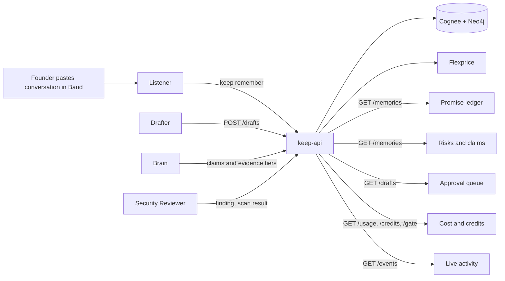
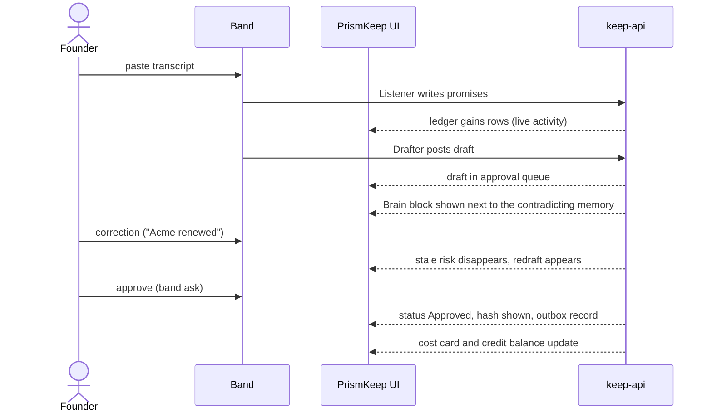

# PrismKeep UI plan (Role 3)

Goal: a product a founder would pay for, readable on a projector at 1080p, built with plain HTML, CSS and JS (no npm, no build step, so the Snyk score stays clean). Band is the main interface for agents. This UI is the founder's ledger: it shows what the agents know, what is waiting for approval, and what it costs.

Served by keep-api at http://127.0.0.1:8787/ . Starter files: `index.html`, `styles.css`, `app.js`.

## 1. Data flow behind each panel

| Panel | Endpoint | What it shows | Judge line it supports |
|---|---|---|---|
| Promise ledger | `GET /memories` (kind=promise) | Who promised what, owner, due date, kept or open, source quote | Cognee 25 |
| Contradiction view | `GET /memories` (claims and risks) plus `GET /drafts` | A draft claim next to the memory that blocks it, with evidence tier | Innovation 10, Cognee 25 |
| Approval queue | `GET /drafts`, `POST /drafts/{id}/approve` status and hash | Draft text, evidence per claim, pending or approved, sha256 | Band 25 (human decision) |
| Agent cost and credits | `GET /usage`, `GET /credits`, `GET /gate/{feature}` | Tokens, tasks, dollars per agent, wallet balance, gated features | Flexprice +10, Band 25 (cost view) |
| Live activity | `GET /events` | Every memory event, cost event and block, newest first | Execution 20 |
| Memory graph (added) | `GET /memories`, `GET /drafts` | Datasets as hubs, memories as nodes, red links for draft vs contradicting memory; dependency free SVG force layout | Cognee 25, Innovation 10 |
| Security panel (add) | scan results stored under `eng_security` | Last scan time, findings, blocked tasks, repeat count, repo score | Snyk +10 |

## 2. Founder flow through the UI

## 3. Layout (one screen, 1080p)

- Top bar: brand, "synthetic data" label, credits remaining, backend badge (local or cognee), Flexprice sync state.
- Left column: Promise ledger (largest), Risks and claims.
- Right column: Approval queue (shows blocked claims inline), Agent cost, Security panel.
- Bottom strip: Live activity, one line per event, color by type.

Every item that comes from memory shows `[memory: dataset / short quote]` so recall is visible in the video.

## 4. Build order against the timeline

| Target | UI deliverable |
|---|---|
| 12:30 | Design direction chosen, promise ledger live on keep-api |
| 13:15 | Contradiction view, approval queue, cost and credits, security panel |
| 13:45 | Empty, loading and error states, polish for recording |
| After 14:00 | Title card, end card with the real security score, captions |

## 5. Rules for this folder

- Render untrusted text (transcripts, LLM output) with `textContent`, never `innerHTML`.
- No external scripts or fonts that need npm. A system font stack is fine.
- No secrets, emails or keys on screen. Check every frame before upload.
- Handle empty, loading and error states for every panel, and show "Flexprice sync pending" when billing is down.
- Contrast and focus rules: readable at projector distance, keyboard focus visible, status never shown by color alone.
- No em dashes or en dashes in copy.

## 6. Skills that help (already installed, none downloaded)

| Skill | Use here |
|---|---|
| `frontend-design`, `ui-ux-pro-max` | Pick the design direction and layout |
| `impeccable` | Polish and critique before recording |
| `fixing-accessibility`, `web-design-guidelines` | Contrast, focus, state handling |
| `frontend-security-coder`, `xss-html-injection` | Keep untrusted text safe in the DOM |
| `mermaid-expert` | Architecture diagram for the README |

How each helps the four tools is in `scoring/README.md`.

## 7. Not looking AI generated

Common tells reported by practitioners (opinion, not research): default font stacks, purple to blue gradients, soft grey shadows on floating cards, emoji icons, colored left borders on cards, an italic accent word in the headline, numbered 01 02 03 markers on content that is not a sequence, generic template layouts, and sterile generated imagery. Sources: capitalandcompute.net "How to Fix AI Slop in Web Design, Tell by Tell", robotsonpayroll.substack.com "how to avoid that vibe coded look", chromatix.com.au "common mistakes when using ai for web design".

What we do instead:

| Tell | Our choice |
|---|---|
| Default fonts | Fraunces for quotes, Hanken Grotesk for headings, JetBrains Mono for data |
| Gradient and card shadows | Flat ink panels, hairline borders, one brass accent, no shadows |
| Template layout | Hero is a live ASCII prism, content is a ledger with a memory graph |
| Decorative icons | None. Status is text chips and the graph |
| Fake numbers | Every number comes from keep-api; demo mode is labelled |
| Vague copy | Plain statements about promises, claims and approvals |

ASCII hero (`ascii.js`): a canvas draws a prism that splits one red beam of promises into a spectrum. Brightness picks a character from a ramp. The pointer pushes glyphs away, brightens them and leaves a decaying heat trail. 30 fps cap, paused off screen, one static frame under reduced motion. Technique notes: brightness to character ramp, heat trail, canvas not DOM (21st.dev ASCII wake and dither components, ui-skills ascii-animation).

Reference clone: `clone/` holds third party repos for study. It is gitignored so their manifests never count against the Snyk score. The kalman-space repo URL is still needed.
